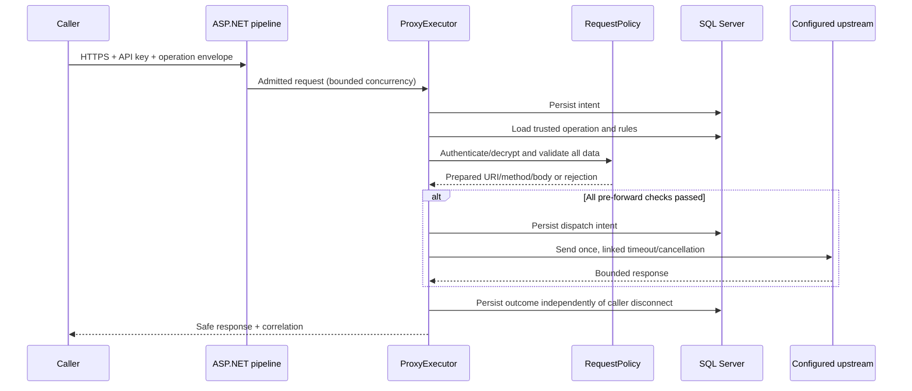

# Design notes

## Scope and trust model

The API only forwards configured operations. `urlId` is treated as the configured destination ID: it must be present in the validated data and match the operation's destination. It is never used as a URL.

The administrator/DBA, deployment settings, destination definitions and DNS are trusted. Caller input and upstream responses are untrusted. SQL access must be restricted. The proxy and admin endpoints use separate shared API keys. There are no permissions per caller yet; production would need an identity provider or mTLS, plus operation grants.

## Responsibilities

`Models.cs` holds the small relational model and contracts. `RequestPolicy` is synchronous and has no network side effects: it converts trusted configuration plus untrusted envelope into a prepared request or a categorized rejection. Its only external dependency is the key source. `ProxyExecutor` owns the execution lifecycle and audit writes. `Program` owns transport, authentication and DI. `ConfigurationAdmin` implements the small configuration mutation use case.

I kept one application project because the current scope doesn't need separate assemblies or a mediator. EF Core already handles the unit of work. Tests cover the executor, HTTP pipeline and SQL-specific behavior.

## Routing and SSRF

Only configured methods GET/POST/PUT/PATCH/DELETE/HEAD are supported. Destination URLs must use HTTPS, contain no userinfo/query/fragment, end with `/`, and match their configured permitted port. Relative templates cannot contain traversal segments, percent escapes, backslashes, schemes, queries or fragments. Path values use an intentionally narrow ASCII identifier alphabet; query values are escaped separately. The completed URI is checked for authority and base-path containment. Dynamic path templates must be completely resolved.

Redirects, cookies, automatic decompression and system proxies are disabled on SocketsHttpHandler. The request carries only headers present in both the operation allowlist and a hard safety allowlist (Accept-Language, X-Request-Id, Idempotency-Key). Headers nominated by an incoming Connection header are excluded as hop-by-hop, even if otherwise allowlisted. No caller Host, credentials, connection headers, cookies or API keys are copied. There is no user-controlled authorization profile in this implementation. Response headers are not copied.

Internal destinations are allowed because they are an explicit business requirement. This implementation does not pin DNS results or enforce IP CIDRs. A compromised trusted configuration or DNS can redirect traffic; production must combine restricted configuration writers, trusted DNS, egress ACLs and optionally a ConnectCallback with organization-specific network allowlists. Blocking all private IPs would break the required internal API scenario.

## Encryption and protection

Profiles contain key references, never key bytes. The environment key source resolves a reference under `PROXY_KEY_` and requires a 32-byte base64 key. It can be replaced by a secret-manager implementation without changing validation. AES-256-GCM uses a 12-byte nonce, 16-byte tag and operation-key UTF-8 AAD. The entire plaintext is authenticated before parsing or forwarding. Temporary plaintext/key arrays are cleared; parsed JSON and request buffers remain managed memory and are not a comprehensive memory-erasure guarantee.

GCM provides integrity and confidentiality, not caller authorization or replay protection. Nonces must not repeat under one key. Each key reference should represent a versioned key; retain old profiles during coordinated rotation, then disable them. There is no automatic key rotation or replay ledger. TLS remains mandatory. Responses are not application-encrypted. No sensitive payloads are persisted. At-rest SQL/storage encryption is a deployment responsibility.

## Resource bounds and lifecycle

The envelope hard limit is 1 MiB, with per-operation limits up to that value. Encrypted requests must fit both the wire-envelope limit and the decrypted-data limit, so base64 overhead reduces usable plaintext size. Responses are limited per operation, never above 8 MiB. Content-Length is checked when present; chunked streams are still limited while reading. Request/response reads use 8 KiB chunks. The bounded result is buffered before emitting response headers so an oversized response can produce a consistent 502. There are temporary array/MemoryStream copies; peak memory is higher than one buffer per request.

32 active proxy requests per instance are admitted with no wait queue; excess gets 429. HttpClientFactory reuses handlers/connections; client-level timeout is infinite because a linked destination deadline covers send and body read. Upstream connections are bounded per server, connection lifetime is two minutes, connect timeout five seconds, and response headers are capped. There is no per-caller request-rate limiter or distributed concurrency limiter; deploy those at ingress for multiple instances. Circuit breaking is deferred: a per-destination breaker can fail fast during outages, but it needs measured thresholds and must never silently introduce retries.

## Reliability and response semantics

Incoming cancellation flows through configuration loading and HTTP I/O. Audit admission and completion each use their own five-second deadline, independent of a disconnected caller. Caller cancellation is recorded as 499, although the disconnected caller may receive no HTTP response. A destination deadline yields 504; connection errors, including an IOException while reading the upstream body, yield 502. An incoming body read failure is a 400. Cancellation can never guarantee that an upstream side effect was undone.

Minimal API binding is configured to throw BadHttpRequestException consistently across environments. The safe exception middleware preserves its 400/415/413 client-error status instead of turning malformed management input into a 503. Exception text is never returned. Invalid base64 management versions are handled by the management use case itself.

There are no automatic retries. A safe retry policy would require an actually idempotent operation, a bounded attempt/time budget and appropriate transient failures. Non-idempotent operations require upstream-supported idempotency or durable deduplication; forwarding an allowlisted Idempotency-Key does not itself implement deduplication. An error after dispatch is not permission to retry a POST blindly.

Upstream non-success statuses, including redirects, are retained with a generic body and `X-Proxy-Source=upstream`. Their original bodies and headers are discarded. Successful bodies are returned as supplied by the trusted destination. A proxy-generated failure uses `X-Proxy-Source=proxy`. No Location is exposed and no redirect is followed. Only application/json is preserved as a response content type; other content becomes application/octet-stream. This is intentionally not a transparent HTTP proxy.

## Configuration consistency and history

There is no configuration cache. Each accepted execution loads configuration afresh with a single EF query. SQL Server's default READ COMMITTED prevents dirty reads but does not promise a database-wide point-in-time snapshot; related configuration updates must be made atomically. If strict statement snapshots are required under concurrent multi-table writes, enable READ_COMMITTED_SNAPSHOT on the deployment database. No long-lived SQL transaction is held across a remote HTTP request.

A request uses its loaded configuration for the remainder of execution. Disabling an operation or destination affects future loads; an already loaded/in-flight request may finish. There is no immediate distributed kill switch. Stronger revocation requires coordination with the dispatch boundary and possibly upstream cancellation support.

Operation and destination have SQL rowversion columns. The exposed operation-enabled update takes an expected base64 version, checks it, and relies on EF/SQL's original-version predicate for the race after that check. A stale update returns 409. SaveChanges atomically records an operation state change with its prior version and timestamp. Direct SQL changes and initial seeding are outside this application history and require audited DBA/deployment processes. A future general administration API must cover destinations and child rules, authenticated actor identity and aggregate version updates; it is deliberately not exposed here.

ProxyDb stamps destination CreatedAt/UpdatedAt on inserts and refreshes UpdatedAt on tracked updates while preserving the original creation time. Direct SQL writes must set timestamps themselves; the context hook is not a database trigger.

## Audit policy and failure windows

Execution audit applies to requests admitted through the HTTPS/authentication/concurrency gates into ProxyExecutor. Rejections at transport/ingress gates belong to ingress security telemetry and do not create an execution row. Oversized/invalid JSON reaching the executor is audited. If no database is available, even a rejection may be reported as audit_unavailable because the mandatory intent cannot be written.

Before network effects, a durable Started row is required. Before Send, Dispatching is persisted with Forwarded=false. Only after that write and a cancellation check is Forwarded set true in memory immediately before invoking Send, then persisted with completion. For completed rows, Forwarded means dispatch was attempted, not confirmed receipt. A failed dispatch-intent write cannot claim forwarding. For unfinished Dispatching rows, Forwarded=false is ambiguous: the process may have sent the request before failing to save completion. SQL cannot atomically commit an HTTP side effect. After a completion-write failure, the proxy emits a Critical metadata-only event and returns 503, retaining the prior durable intent. Operators must reconcile unfinished attempts and clients must avoid blind retries. A transactional outbox would improve asynchronous delivery durability but would change the synchronous API contract and still require upstream deduplication.

Audit stores correlation, known operation key, destination ID, timestamps, duration, dispatch flag, upstream/proxy status, outcome and fixed reason codes. It excludes user payload text, secrets and exception messages. Unknown keys are not persisted verbatim. Configure retention, indexing/partitioning as volume grows, access restrictions, alerts for failed audit completion and reconciliation of stale Started/Dispatching records.

## Verification boundaries

Tests with EF InMemory exercise behavior without pretending to validate SQL transactions or generated rowversion. Optional SQL integration tests perform migrations, exercise a genuine stale-writer race, and verify successful/rejected audit persistence with a fresh context. HTTP tests exercise middleware, endpoint binding, successful forwarding and the 32-request concurrency gate with TestServer.

NetworkTests starts a real local Kestrel HTTPS destination and keeps the application's production named HTTP client settings. Only the test client's trust roots are replaced with a freshly generated certificate; no global trust store is changed and no accept-all certificate callback is used. The test records received requests and checks real dispatch, traversal rejection and non-following of redirects. On Windows the generated certificate is exported/imported as PFX so Schannel can access its private key.

The GitHub workflow also starts the standalone API and mock against SQL Server 2022. Its smoke script checks forwarding, blocked requests, management concurrency, AES-GCM and persisted audit records. Both SQL integration tests and this standalone run passed in CI. See docs/VERIFICATION.md for the verified run and local setup details.
